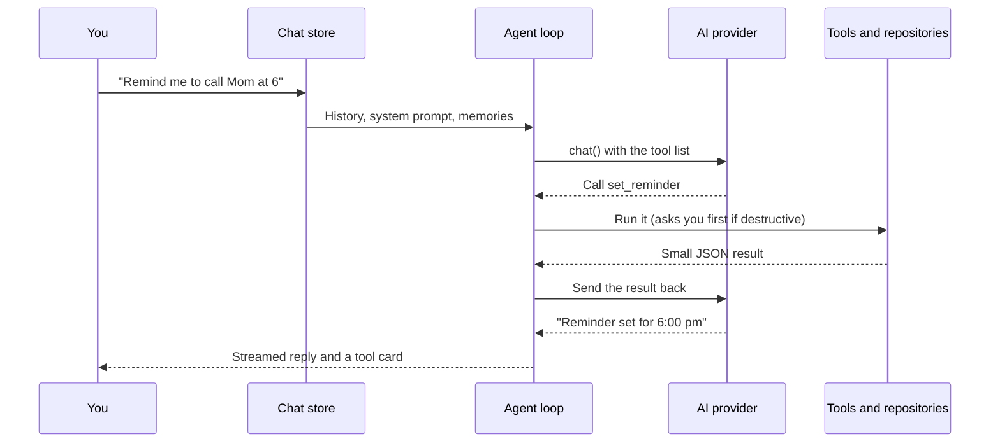

# Nova

A personal AI assistant for Android. You talk to one assistant, by text and later by voice, and it does the work across your own notes, music and files on the phone.

> "Note that the electricity bill is due on the 15th." · "Play some Arijit Singh." · "Summarise the PDF I uploaded yesterday."

Nova is built for a single user: no accounts, no servers, no Play Store. Your data stays on the phone; only the text needed for a request goes to the AI provider you choose. "Nova" is a working name.

## Contents

- [Status](#status)
- [Getting started](#getting-started)
- [Commands](#commands)
- [Project structure](#project-structure)
- [How a request works](#how-a-request-works)
- [Data](#data)
- [Privacy and safety rules](#privacy-and-safety-rules)
- [Adding a tool](#adding-a-tool)
- [Building and installing](#building-and-installing)
- [Conventions](#conventions)
- [Roadmap](#roadmap)

## Status

The app will have four tabs: **AI**, **Notes**, **Music** and **Files**. The AI tab is the hub: the assistant reaches the other three only through defined tools. Today only the AI tab exists.

| Phase | Scope | Status |
| --- | --- | --- |
| 1. Skeleton and Notes | Tabs, database and migrations, Notes list, editor and search, private notes behind fingerprint unlock, Settings | Partly done: database, migrations and Settings exist; Notes not started |
| 2. Music | Device library and imports, player, background and lock-screen playback | Not started |
| 3. Files | Import PDF, DOCX and TXT, extract their text for the AI | Not started |
| 4. AI chat with tools | Provider wrapper, agent loop, tool cards, confirmations | In progress: done except the Notes, Music and Files tools, which wait for those tabs |
| 5. In-app voice | Speech to text, text to speech, hands-free mode | Not started |
| 6. Lock-screen voice | "Hey Nova" wake word in a native foreground service | Not started |
| 7. Polish | Database encryption, backups, RAG for large files, OCR, widgets | Not started |

### What works today

- **Chat** with streaming replies, Stop and Retry, and saved conversations. The last 20 messages go with each request.
- **Regenerate and edit**: redo the latest reply, or edit your last message and send it again.
- **Markdown** including tables, and code blocks with a Copy button that scroll sideways instead of wrapping.
- **Chats** get a short title written by the model after the first answer, and you can search them by title or message text.
- **Custom instructions**: tell Nova about yourself and how to reply, in Settings. They go with every message.
- **Any AI service**: OpenAI, Anthropic, Google Gemini, OpenRouter, Groq, DeepSeek, Ollama or LM Studio on your network, or any OpenAI-compatible URL. Save several profiles, and switch provider and model from the chat header, with your recent picks one tap away.
- **Tools** with a visible card for every call. Destructive tools ask you first.

  | Tool | What it does |
  | --- | --- |
  | `search_chats` | Searches your earlier conversations |
  | `remember` / `forget` | Saves or removes a fact about you |
  | `set_reminder` / `list_reminders` / `cancel_reminder` | Schedules, lists or deletes a reminder notification |

- **Long-term memory**: facts the AI saves are sent with every message, and you can view and delete them in Settings.
- **Reasoning models**: their thinking is shown folded above the answer. A reply that hits the length limit gets a **Continue** button. Models without tool support fall back to plain chat.

## Getting started

### Prerequisites

- **Node.js 24.20** and **npm 11.19**, the versions EAS builds with (see `eas.json`). An older npm can write a `package-lock.json` that EAS's `npm ci` rejects.
- An **Android phone** with a Nova development build installed (see [below](#development-build)).
- An **Expo account** for EAS cloud builds.
- An API key for at least one AI service, or Ollama or LM Studio running on your computer.

### Run the app

```bash
npm install
npx expo start
```

Open the app on your phone with the Nova development build and scan the QR code.

### Development build

Nova uses native modules that Expo Go doesn't include, so it runs in its own development build. Build it in the cloud and install the APK from the link EAS prints:

```bash
npx eas-cli@latest build --profile development --platform android
```

Make a new development build whenever you add a package with native code, or change plugins or permissions in `app.json`. Until then, the app keeps running on the old build, and features that need the new native code are unavailable. Reminders, for example, say they need a newer build.

If you have the Android SDK installed, `npx expo run:android` builds and installs it locally instead.

### Web preview

`npx expo start --web` is handy for quick UI checks, but it isn't the real app:

- API keys are kept in the browser's `localStorage` instead of secure storage.
- Reminders aren't available.
- Confirmations use a dialog drawn by the app, because embedded browsers block `window.confirm`.

### Connect an AI service

In the app, open **Settings → Add provider**, pick a service, paste your API key and choose a model.

- Paste only the key itself. A label in front of it, such as `openrouter: sk-…`, is rejected.
- Keys are stored with `expo-secure-store`, backed by the Android Keystore, never in the database.
- **Ollama or LM Studio**: use your computer's network address, not `localhost`, for example `http://192.168.1.10:11434/v1`. The phone and the computer must be on the same Wi-Fi. Plain `http://` is allowed for this.

## Commands

```bash
npx expo start                 # start the dev server
npx expo lint                  # lint
npx tsc --noEmit               # typecheck
npx expo-doctor                # check dependencies and config
npx expo install <package>     # add a package (picks the SDK-compatible version)
npx expo install --fix         # fix incompatible package versions
```

Run lint and the typecheck before calling any change done.

## Project structure

```
src/
├── app/                    # Screens; every file is a route (Expo Router)
│   ├── _layout.tsx         # Root: theme, SQLite, provider loading, confirm dialog
│   ├── (tabs)/             # Bottom tabs; index.tsx is the AI chat
│   ├── conversations.tsx   # Past chats
│   ├── settings.tsx        # Providers, model, memory, reminders, data
│   ├── provider/[id].tsx   # Add or edit an AI provider
│   └── models.tsx          # Switch the active model
├── ai/
│   ├── llm.ts              # chat() and listModels(): the only way to reach a provider
│   ├── providers/          # Request and stream formats: OpenAI-compatible, Anthropic
│   ├── agent.ts            # Tool-calling loop
│   ├── tools/              # Tool definitions and handlers, one file per group
│   ├── prompt.ts           # System prompt
│   ├── presets.ts          # Known services that pre-fill the provider form
│   ├── sse.ts, think.ts    # Stream parsing, <think> tag splitting
│   └── types.ts            # Shared provider-layer types
├── db/                     # migrate.ts and one repository per table
├── services/               # Device services (reminders); more to come (player, extraction, voice)
├── store/                  # Zustand stores: chat, providers
├── components/             # Shared UI: message bubbles, tool cards, composer, dialogs
├── lib/                    # Small helpers: secure keys, confirm, navigation
└── theme.ts                # Colours, spacing, radii
```

`*.web.ts` files replace their native twin in the web preview. The `android/` and `ios/` folders are generated and not checked in.

## How a request works

The AI never touches your data directly. It asks for a tool, the app runs it, and the result goes back to the model until it gives a final answer.



- The loop stops after **5 rounds** of tool calls so a confused model can't loop forever.
- A tool never throws. Failures come back as `{ error }`, and declined actions as `{ declined }`, so the model can explain what happened.
- Each reply and tool result is saved as soon as it exists, so a chat reopens with its tool cards intact.
- If a model rejects tools, Nova asks again without them and remembers that for the rest of the session.

## Data

Everything lives in one SQLite database, `nova.db`, on the phone. Timestamps are Unix milliseconds.

| Table | Holds |
| --- | --- |
| `conversations` | Chats: title, created and updated times |
| `messages` | User, assistant and tool messages. `content` is JSON: text, model, reasoning, tool calls or results |
| `providers` | Saved AI services: name, format, base URL, model. No keys |
| `memories` | Facts the AI saved with `remember` |
| `settings` | Key-value settings, such as the active provider |

Planned: `notes` with full-text search (`notes_fts`), `files` and `tracks`.

Migrations in `src/db/migrate.ts` are numbered and applied in order based on `PRAGMA user_version`, so updating the app never wipes data. Never edit a migration that has shipped; add a new one.

Reminders aren't in the database: the system's notification schedule is the list, and each reminder carries its text and time in its data.

## Privacy and safety rules

These are enforced in code, not left to the prompt.

- **API keys** stay in secure storage and are sent only to the service they belong to.
- **Only what's needed leaves the phone**: the recent messages, your saved memories and whatever a tool returns, never whole tables.
- **Destructive actions need your confirmation** on screen. `forget` and `cancel_reminder` ask before they run, and a "no" goes back to the model.
- **Content from tools is data, not instructions**: the system prompt says so, and destructive actions still need confirmation, which limits prompt injection from chats or files.
- **Private notes will never reach the AI** (planned with Notes): every note query a tool uses filters out private notes in the repository layer, and opening them needs fingerprint or face unlock.

## Adding a tool

1. Add it to a file in `src/ai/tools/` (or a new file for a new group) as a `Tool`. A `Tool` has:
   - `name`, `description` and a JSON Schema `inputSchema` that the model reads.
   - `icon` and `label(input, result)` for its card in the chat.
   - `run(input, context)`, which does the work and returns small JSON.
   - Optionally `confirm(input, context)`, for anything destructive.
2. Register it in `TOOLS` in `src/ai/tools/index.ts`.
3. Read inputs with `stringInput` and `integerInput`. Models send wrong or missing fields; throw an `Error` with a message the model can act on.
4. Call repositories and services, never raw SQL, so the AI and the screens behave the same way. Note tools must ask for public notes only.
5. Return what the model needs, not whole records. Cut long text and say it was cut.

In development, every tool call and its result is logged to the console.

## Building and installing

Profiles in `eas.json` (all build an APK you install directly):

| Profile | Use |
| --- | --- |
| `development` | Development build with the dev client, for daily work |
| `preview` | Standalone build for testing on the phone |
| `production` | Release build, version code bumped automatically |

```bash
npx eas-cli@latest build --profile production --platform android
```

Download the APK from the build page, copy it to the phone and install it (allow "Install unknown apps"). Updates must be signed with the same key, or Android refuses to install over the old app and you lose its data. EAS keeps the signing key; download a backup with `npx eas-cli@latest credentials`.

## Conventions

- **Expo SDK 58.** Expo changes between SDKs, so check the [versioned docs](https://docs.expo.dev/versions/v58.0.0/) before using an API. Add packages with `npx expo install`.
- **Expo Router** for navigation. Only screens go in `src/app/`; components, hooks and helpers live outside it.
- **Never edit `android/` or `ios/`.** Configure native behaviour in `app.json` and config plugins.
- **Screens stay thin**: they call repositories and services, never raw SQL.
- **TypeScript strict mode**; ESLint from `eslint-config-expo`.
- **Commit after every working feature.**

## Roadmap

From the product spec, in build order:

- **Notes**: list, editor with autosave, search, private and public notes, biometric lock. Tools: `create_note`, `search_notes`, `get_note`, `update_note`, `delete_note`.
- **Music**: device library and imports, player screen, background and lock-screen controls. Tools: `search_music`, `play_music`, `control_playback`, `now_playing`.
- **Files**: import PDF, DOCX and TXT, extract their text, view and share them, save AI-written text as files. Tools: `list_files`, `read_file`, `save_file`.
- **In-app voice**: a mic button, hands-free conversation, music ducking; English, Hindi and Gujarati.
- **Lock-screen voice**: a Kotlin wake-word service (Porcupine) that starts the assistant with the screen off.
- **Later**: database encryption, backups, RAG and OCR for large or scanned files, conversation summaries, widgets, offline AI, iOS.

iPhone support is out of scope for now: iOS doesn't let third-party apps listen for their own wake word.
