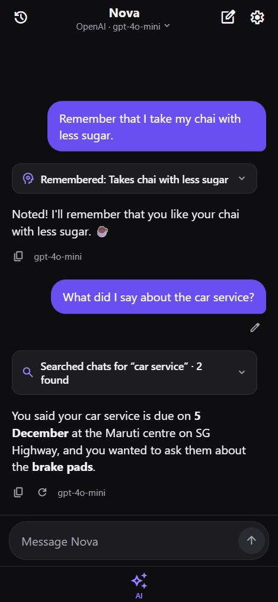
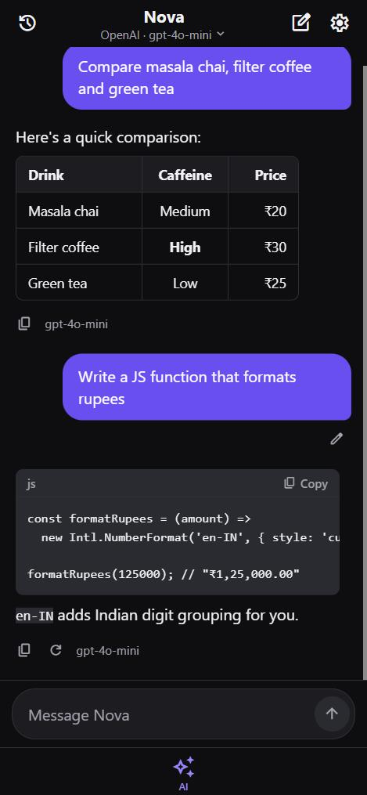
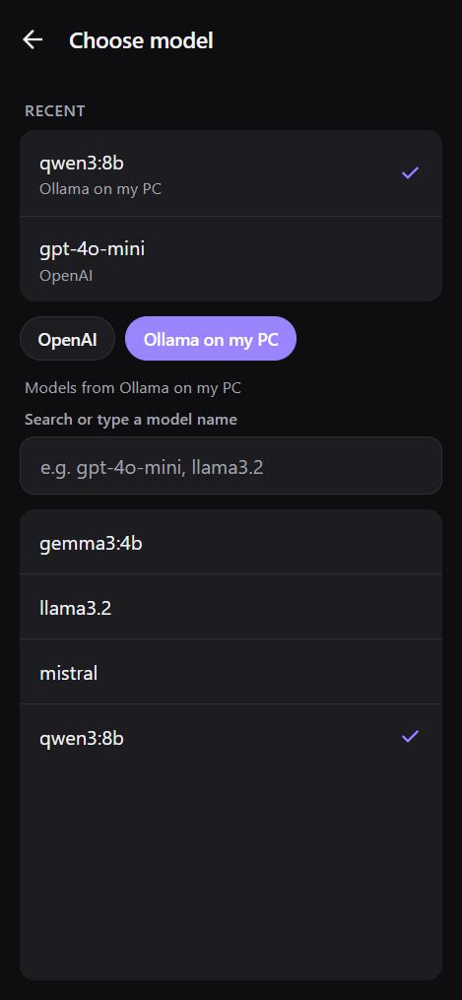

# Nova

A personal AI assistant for Android that works with your own data on the phone.

You talk to one assistant, and it does the work for you: it saves and finds your notes, remembers what matters to you, and sets reminders. Nova is built for a single user. There are no accounts and no server; your data stays on the phone, and only the text needed for a request goes to the AI service you choose.

**Download:** the latest APK is on the [Releases page](https://github.com/dhruvil05/nova-ai-app/releases).

## Key features

- **AI chat** with any service: OpenAI, Anthropic, Gemini, OpenRouter, Groq, DeepSeek, Ollama, LM Studio or any OpenAI-compatible URL.
- **Actions through tools**: notes, chat search, memory and reminders, with a card for every action and a confirmation before anything is deleted.
- **Notes** with autosave and full-text search.
- **Private notes** the AI can never see, locked behind fingerprint, face or screen lock.
- **Long-term memory** and custom instructions that shape every reply.
- **Rich replies**: Markdown with tables and copyable code, reasoning models' thinking, regenerate and edit.

## Technology

Expo SDK 58 (React Native 0.88, React 19) · TypeScript · Expo Router · SQLite (`expo-sqlite`, with FTS5 search) · Zustand · Jest · EAS Build

## Screenshots

<table>
  <tr>
    <td align="center" width="33%">
      
      <br /><sub><b>Tools</b>: a card for every action</sub>
    </td>
    <td align="center" width="33%">
      
      <br /><sub><b>Tables and code</b></sub>
    </td>
    <td align="center" width="33%">
      
      <br /><sub><b>Switch provider and model</b></sub>
    </td>
  </tr>
</table>

More in [docs/usage.md](docs/usage.md).

## Quick start

```bash
git clone https://github.com/dhruvil05/nova-ai-app.git
cd nova-ai-app
npm install
npx expo start
```

Nova runs in its own development build, not Expo Go. See [installation](docs/installation.md) to build and install it, then add an AI service in **Settings → Add provider**.

## Documentation

| Guide | Covers |
| --- | --- |
| [Installation](docs/installation.md) | Prerequisites, development build, first run |
| [Configuration](docs/configuration.md) | AI providers, in-app settings, `app.json`, `eas.json` |
| [Usage](docs/usage.md) | Chat, AI actions, notes, private notes, personalisation |
| [Architecture](docs/architecture.md) | Layers, request flow, data model, privacy rules |
| [Development](docs/development.md) | Commands, project structure, conventions, adding a tool |
| [Testing](docs/testing.md) | Jest setup, the privacy test, manual checks |
| [Deployment](docs/deployment.md) | Building APKs, signing, releasing |
| [Troubleshooting](docs/troubleshooting.md) | Common errors and known limitations |
| [Roadmap](docs/roadmap.md) | Build phases and what's next |

## License

The repository includes an MIT [LICENSE](LICENSE) file inherited from the Expo project template; its copyright line names 650 Industries, Inc. (Expo).
