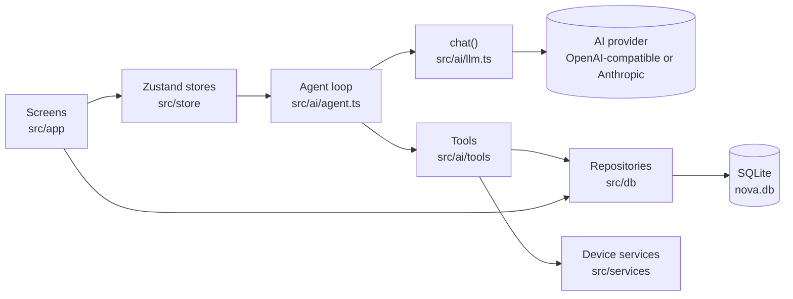
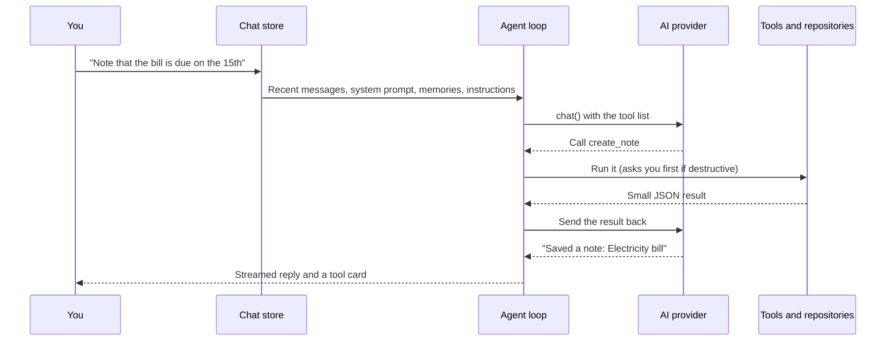

# Architecture

How Nova is put together: its layers, how a request flows through the AI, where data lives, and the rules that keep it private.

## Contents

- [Overview](#overview)
- [How a request works](#how-a-request-works)
- [AI provider layer](#ai-provider-layer)
- [Data](#data)
- [Privacy and safety rules](#privacy-and-safety-rules)
- [Platform differences](#platform-differences)

## Overview

Nova runs entirely on the phone. There's no backend: the app talks directly to the AI provider you configure.

| Layer | Location | Responsibility |
| --- | --- | --- |
| Screens | `src/app/` | Expo Router routes. Thin: they call stores, repositories and services, never raw SQL |
| Stores | `src/store/` | Chat state and streaming, providers, the private-notes lock, a notes change signal |
| AI | `src/ai/` | Provider adapters, the agent loop, tools, the system prompt |
| Repositories | `src/db/` | All SQL, one file per table, plus migrations |
| Services | `src/services/` | Device features (reminders via `expo-notifications`) |
| Helpers | `src/lib/` | Secure keys, confirmation dialogs, device unlock, formatting |

The screens and the AI use the **same repositories**, so a note the AI creates is exactly like one you type.

## How a request works

The AI never touches data directly. It asks for a tool, the app runs it, and the result goes back to the model until it gives a final answer.

- **Context**: the last 20 messages are sent, extended back to the start of the turn so a tool result is never separated from its call.
- **Loop cap**: at most 5 rounds of tool calls per request.
- **Tools never throw**: failures return `{ error }` and declined actions `{ declined }`, so the model can explain what happened.
- **Saved as it goes**: each reply and tool result is stored as soon as it exists, so a chat reopens with its tool cards intact.
- **Titles**: after the first answer in a chat, a separate short request (up to 256 tokens) asks the model for a 2–6 word title.

## AI provider layer

`src/ai/llm.ts` exposes `chat()` and `listModels()`, the only ways to reach a provider. Two adapters in `src/ai/providers/` cover every service:

| Adapter | Used by |
| --- | --- |
| `openai.ts` | OpenAI and every OpenAI-compatible service (Gemini, OpenRouter, Groq, DeepSeek, Ollama, LM Studio, custom) |
| `anthropic.ts` | Anthropic's Messages API |

They stream Server-Sent Events (`sse.ts`) and handle tool calls that arrive in pieces. They also pick up reasoning from either a separate field or `<think>…</think>` tags (`think.ts`), and report when a reply hit the 4,096-token limit. If a model rejects tools, `chat()` retries without them and remembers that for the rest of the session.

## Data

Everything lives in one SQLite database, `nova.db`. Timestamps are Unix milliseconds.

| Table | Holds |
| --- | --- |
| `conversations` | Chats: title, created and updated times |
| `messages` | User, assistant and tool messages. `content` is JSON: text, model, reasoning, tool calls or results |
| `providers` | Saved AI services: name, format, base URL, model. No keys |
| `memories` | Facts the AI saved with `remember` |
| `notes` | Title, body, private flag, written by `user` or `ai` |
| `notes_fts` | FTS5 full-text index of `notes`, kept in sync by triggers |
| `settings` | Key-value settings |

**Not in the database:**
- **API keys** live in `expo-secure-store`.
- **Reminders** live in the system's notification schedule; each carries its text and time in its data.

**Migrations** (`src/db/migrate.ts`) are numbered and applied in order using `PRAGMA user_version`, so updating the app never wipes data. Never edit a migration that has shipped; add a new one.

## Privacy and safety rules

These are enforced in code, not left to the prompt.

- **Private notes never reach the AI.** Every note query takes an explicit `includePrivate` choice. The note tools always pass `false`. The Notes list passes `true` only while notes are unlocked, and the editor hides a private note's text while locked. A private note looks to the AI exactly like a missing one. `test/notesPrivacy.test.ts` proves this; see [testing.md](testing.md).
- **Private notes need the owner.** Viewing them asks for fingerprint, face or screen lock (`src/lib/unlock.ts`), and they lock again when the app goes to the background (`src/store/privacyStore.ts`).
- **Only what's needed leaves the phone**: recent messages, memories, custom instructions and whatever a tool returns, never whole tables.
- **Destructive actions need confirmation.** `forget`, `cancel_reminder` and `delete_note` ask on screen first, and a "no" goes back to the model.
- **Tool output is data, not instructions.** The system prompt says so, and destructive actions still need confirmation, which limits prompt injection from stored content.
- **API keys** stay in secure storage and are sent only to their own provider.

## Platform differences

Files ending in `.web.ts` replace their native twin in the web preview:

| Module | Android | Web preview |
| --- | --- | --- |
| `lib/secrets` | `expo-secure-store` | `localStorage` |
| `lib/confirm` | System alert | Dialog drawn by the app |
| `lib/unlock` | Fingerprint, face or screen lock | Dialog stand-in (protects nothing) |
| `services/reminders` | `expo-notifications` | Unavailable |

The web build's SQLite has no FTS5, so migration 3 skips `notes_fts` there and note search falls back to `LIKE`. Android always has FTS5.
