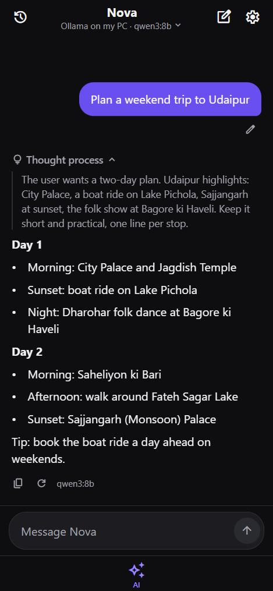
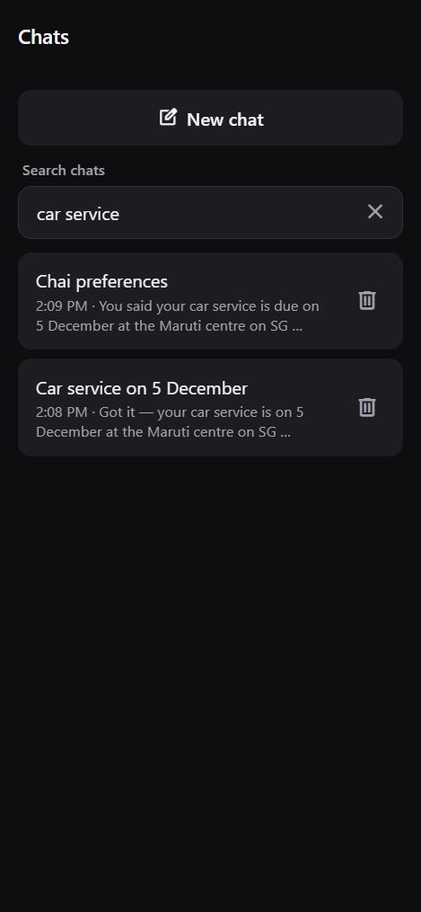
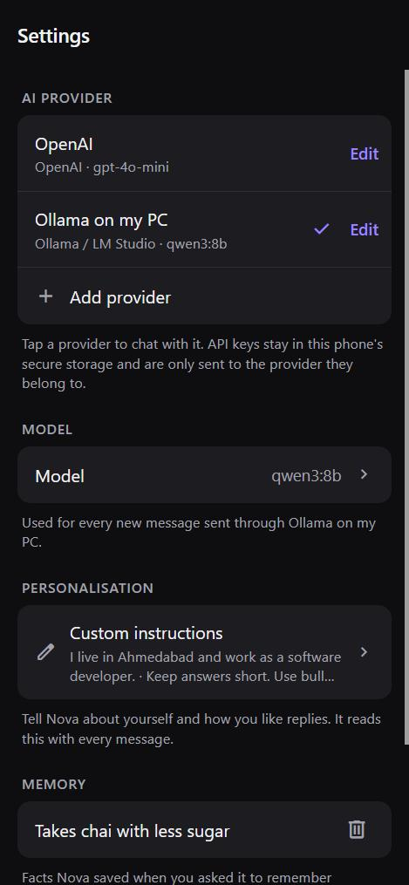

# Usage

What you can do with Nova today. Nova has two tabs: **AI** (the assistant) and **Notes**. Setup is covered in [installation.md](installation.md) and [configuration.md](configuration.md).

## Contents

- [Chatting](#chatting)
- [What the AI can do for you](#what-the-ai-can-do-for-you)
- [Notes](#notes)
- [Private notes](#private-notes)
- [Personalising Nova](#personalising-nova)

## Chatting

- **Send a message** and the reply streams in. Tap **Stop** to end it early; the text so far is kept.
- **Markdown** replies render headings, lists, quotes, tables and code blocks. Code blocks have a **Copy** button and scroll sideways instead of wrapping.
- **Regenerate** the latest reply, or **edit** your last message and send it again, with the buttons under them. Both re-run any actions in that reply, so regenerating a reply that set a reminder sets it again.
- **Continue**: a reply that hit the length limit says so and offers to continue.
- **Reasoning models** show their thinking folded above the answer.
- **Switch provider or model** by tapping the model name in the chat header. Recent picks are one tap away.
- **Past chats** (the clock icon) get a short title written by the model after the first answer. Search them by title or message text.
- **Retry** appears when a request fails.

  
  

## What the AI can do for you

Nova acts through tools. Each action shows as a card in the chat; tap a card to see exactly what was sent and returned. Anything that deletes something asks you first.

| You might say | Tool |
| --- | --- |
| "Note that the electricity bill is due on the 15th" | `create_note` |
| "What did I note about the car service?" | `search_notes`, then `get_note` |
| "Add milk to my shopping list" | `update_note` (append) |
| "Delete the old Wi-Fi note" | `delete_note` (asks first) |
| "What did we talk about last week?" | `search_chats` |
| "Remember that I prefer short answers" | `remember` |
| "Forget that I live in Pune" | `forget` (asks first) |
| "Remind me to call Mom at 6 pm" | `set_reminder` |
| "What reminders do I have?" / "Cancel that reminder" | `list_reminders` / `cancel_reminder` (asks first) |

If a model doesn't support tools, Nova falls back to plain chat and shows "no tool support" under its replies.

## Notes

The **Notes** tab lists your notes, newest first.

- **Write**: tap **+**. The editor saves 500 ms after you stop typing, and again when you leave. A new note you leave empty isn't kept.
- **Search** finds notes containing every word you type; word starts count ("elec" finds "electricity").
- **Filter** by All, Public or Private.
- **Badges**: a lock marks private notes; **AI** marks notes Nova wrote.
- **Delete** from the editor's trash icon; it asks first.

## Private notes

Private notes are for things the AI must never see.

- **Make a note private** with the lock button in the editor. This asks for your fingerprint, face or screen lock first.
- **Hidden from the AI**: no AI tool can find, read, change or delete a private note. To the AI it looks like the note doesn't exist.
- **Locked by default**: until you unlock, private notes are left out of the list and search, and a row says how many are hidden. Choosing the Private filter or tapping **Unlock** asks for your fingerprint, face or screen lock.
- **Locks again** whenever Nova goes to the background, or when you tap the lock button in the Notes header. A private note that's open when Nova locks is hidden until you unlock again.

If the phone has no screen lock at all, there's nothing to check against, so private notes are reachable without a prompt.

## Personalising Nova

- **Custom instructions** (Settings → Personalisation): tell Nova about yourself and how you like replies. They're sent with every message.
- **Memory** (Settings → Memory): facts Nova saved with `remember`. They're sent with every message; delete any you don't want.
- **Exact reminder times** (Settings → Reminders): without Android's "Alarms & reminders" permission, reminders may arrive a few minutes late.

